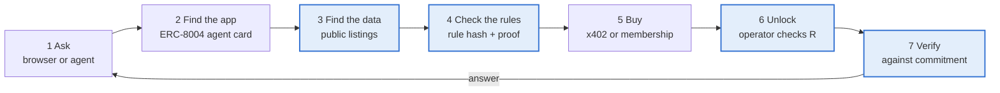

# Fangorn Foundations

*Draft, 2026-10-11 · driemworks. Shared doc: https://claude.ai/code/artifact/a46663af-fc1e-433b-9965-15e952c39b15*

## Abstract

A publisher who wants to share data on the open web faces three problems. Readers must be able to find it, they must be able to trust what it is before they are allowed to see it, and they must be able to obtain it once they are entitled to. Today each is solved by a server the publisher runs and the reader trusts: a search engine that sees every query, a seller's description that cannot be checked, and a gatekeeper that holds the keys. We study how far these servers can be removed.

We take an opinionated view of what is being shared. We model an application's state as a family of graphs: each authorized publisher maintains its own typed graph, versioned over time, and every graph in the family obeys the application's rules, such as which kinds of edges may join which kinds of vertices. Most application state can be written this way, from a registry of clinical trials to a record of council votes, so the result is closer to a state-management system than to a document store. Graphs also make the interesting promises expressible. "Every outcome belongs to exactly one trial" is a statement about edges, and so is the link between a public description and the sealed record it describes.

We give a construction in which parts of a graph can be sealed and still be checked. Sealed blocks are encrypted deterministically, so successive versions share storage, and every update carries a zero-knowledge proof that the hidden graph obeys the application's rules. Search runs in the reader's browser over public descriptions, so no one learns what was sought. Obtaining sealed data still relies on a trusted operator that checks an on-chain condition and releases keys; we describe how threshold encryption with silent setup can replace it, and what remains open. The result needs no server of its own: an application is a static website that people search privately and software agents use directly.

## 1. Introduction

Most applications are, underneath, a body of shared state: records, the relationships between them, and a history of changes, written by some set of parties under some set of rules. On the open web that state lives on a server. The server decides who may write, keeps the history, answers the queries, and is trusted on all three counts.

Three problems follow for anyone who wants to share such state openly. Readers must be able to find it without revealing what they are looking for. They must be able to trust what it is before they are allowed to see it, because some of it may be sealed and for sale. And they must be able to obtain it once they are entitled to. Fangorn removes the server from each of these as far as it currently can, for two kinds of reader: a person in a browser, and an agent that cannot read terms of service but can check a proof.

### 1.1 Applications as families of graphs

We take a deliberately opinionated view: an application is a family of graphs. Each authorized publisher maintains its own graph, and each graph is a version-controlled time series, so the state of an application at any moment is the set of its publishers' latest graphs. The application fixes the rules every graph must obey, chiefly which typed edges may connect which typed vertices.

We chose graphs for their generality. A catalog, a ledger of votes, a social feed and an agent's memory all fit, and a document is simply a vertex with a large payload. The choice also pays for itself in three specific places:

- **The rules worth proving are about relationships.** "Every outcome belongs to exactly one trial" cannot be checked one record at a time.
- **A listing is an edge.** The link between a public description and a sealed record is what lets a reader trust an offer before seeing it.
- **Names are global.** A vertex is named by the hash of its content, so an edge in one publisher's graph can point into another's, and separate applications can build on each other.

### 1.2 Apps without a runtime

A Fangorn app is a static site. Its records come from the chain head and content-addressed storage, and its search index ships as files that are queried in the browser. There is no application server, so there is no query log and nothing to keep running. The same page registers its tools over WebMCP, so an agent driving a browser uses the app the way a person does, and `fangorn-mcp` reaches it without a browser at all.

This works today for public data. Kingsfoil searches 60,760 clinical trials entirely in the reader's browser. Quorum, a catalog of US local-government decisions, is also a registered ERC-8004 agent that sells structured decisions over x402. What follows extends the same model to data that is sealed and sold.

### 1.3 The full circle

The whole system exists to make one loop work: a reader, person or agent, finds data they have never seen, decides it is worth buying, buys it, and checks that they got what they paid for.

*Highlighted steps are defined in this document; the rest work today.*

1. **Ask.** A person searches the app's page, or an agent reaches it through WebMCP or `fangorn-mcp`.
2. **Find the app.** Apps are discoverable without a central index. Each is registered on-chain as an ERC-8004 agent with an agent card, and apps can be ranked against a question by their published embeddings without downloading any corpus.
3. **Find the data.** Search runs locally, over public records and over the public listings of sealed ones: a description, metadata or a preview the seller chose to publish. The sealed payload itself is never embedded.
4. **Check before buying.** The app's rule set is committed on-chain, and every accepted update was proven to follow it. The reader knows the shape of what they are buying without seeing it.
5. **Buy.** Payment goes over x402, or buys a membership with a signed USDC authorization. The membership is anonymous.
6. **Unlock.** The release operator checks the membership on-chain and releases the key; decryption happens locally.
7. **Verify.** The reader checks the plaintext against the commitment they already trusted and the listing that led them there.

Steps 1, 2 and 5 work today, and so does step 3 for public records. Steps 3 to 7 for sealed records are what this document defines.

### 1.4 Contributions

- A model of applications as families of versioned, typed graphs under shared rules, with explicit security goals (§2, §3).
- A first construction: deterministic encryption that keeps structural sharing, key regression aligned to membership epochs, and incremental zero-knowledge proofs that every update follows the application's rules (§4).
- Private discovery over sealed data, in which only public listings are embedded and search runs in the reader's browser (§5).
- One static artifact that serves people and agents alike (§6).
- A path from a trusted release operator to threshold encryption with silent setup, framing release conditions as practical witness encryption (§7).

## 2. Model

An application is a family of versioned graphs that share a rule set. We define the pieces in turn: graphs, their versions, the applications they form, the rules, and the conditions under which sealed parts are released.

**Graphs.** A graph is G = (V, E, τ). Each vertex v carries a type τ(v) and a payload; each edge e = (s, r, t) links two vertices by a relation r. Vertices, edges and the pages that list them are blocks, each addressed by the hash of its bytes (a CID). The root of G is the CID of its namespace tree.

**Versions.** A publisher p keeps its graphs for application A in subspaces s. Each triple (A, p, s) names one timeline, whose on-chain key is

$$
ns = H(A \,\|\, p \,\|\, s)
$$

The registry stores one head per timeline, `head[ns]`. A commit is c = (root, parents, t), and pushing c to ns succeeds only if the current head is an ancestor of c, so history extends and never rewrites. Only p can move `head[ns]`.

**Applications.** An application is A = (Φ_A, P_A): a rule set and the set of publishers authorized to write under it. Its state at time t is the family of its publishers' latest graphs,

$$
S_A(t) = \{\, G_{ns}(t) \;:\; ns = H(A \,\|\, p \,\|\, s),\ p \in P_A \,\}
$$

and the application is well-formed when every member satisfies Φ_A. Readers build their own views of S_A(t), such as the union of all members or the graphs of one publisher; the protocol fixes the family, not the view.

**Why a family, not one graph.** Each publisher owns its timeline outright: no publisher can rewrite another's history, and no coordination is needed to write. The rule set is what makes the separate graphs one application.

**Links across graphs.** Because vertices are named by content hash, an edge may point at a vertex in another member of the family, or in another application altogether. Whether Φ_A allows such edges, and of which types, is the application's choice.

**Rule sets.** An application commits a rule set Φ on-chain as its hash h(Φ). In this document Φ contains:

- allowed triples: a set of (source type, relation, target type);
- required fields per vertex type;
- referential integrity: every edge endpoint is a vertex of the graph;
- optional cardinality bounds, such as "every vote links to exactly one meeting".

We write G ⊨ Φ when G satisfies every rule.

**Release conditions.** A release condition is an NP relation R over a public statement x and a witness w. For a resource identified by ρ and a requester q, the statement is x = (ρ, q, chain state), and the witness is whatever proves q is entitled to ρ. The condition used throughout is membership:

$$
R_{\mathsf{mem}}\big((\rho, q, \sigma),\, \mathsf{tok}\big) = 1 \iff \mathsf{canRead}_\sigma(\mathsf{tok}, q).\mathsf{until} > \mathsf{now}
$$

where σ is the chain state and `canRead` is a view on the membership registry. A **gadget** pairs a release condition with a mechanism that enforces it. The rest of this document varies the mechanism while keeping the condition fixed.

## 3. Security goals

We state four goals, each against a named adversary. Informal statements here; game-based definitions are future work.

| Goal | Statement | Adversary |
| --- | --- | --- |
| **Confidentiality up to leakage** | Anyone not holding a released key learns nothing about a namespace's contents beyond a leakage function L(G₁, …, Gₖ) over its history | Storage hosts, the chain, other members, anyone fetching blocks |
| **History integrity** | An accepted commit always extends the previous head | A publisher or relayer trying to rewrite or fork history |
| **Validity** | If `head[ns]` is accepted under rule set Φ, then the graph it names satisfies Φ | A publisher pushing data that breaks the app's rules |
| **Access correctness** | A key is released to q for ρ if and only if R(x, w) holds for some w | Requesters without entitlement; in v1, not the release operator |

**What L contains in v1.** Block sizes and counts; commit timing; which pages changed between commits; equality of identical blocks within one key epoch; and the namespace name. L does not contain vertex payloads, edge endpoints or relation names. Public listings of sealed records (§5) are published by the seller's choice and sit outside L; sealed payloads are never embedded and add nothing to it.

**What v1 does not protect against.** The release operator sees every key it releases and could release keys it should not. Revocation is forward-only: a former member keeps what they already read. Both limits are stated, not hidden; §7 addresses the first.

## 4. Construction v1

v1 meets all four goals except that access correctness trusts one release operator.

### 4.1 Encrypted namespaces

Every block below the namespace root is encrypted with a deterministic authenticated scheme, and its CID is computed over the ciphertext:

$$
\mathsf{nonce} = \mathsf{HMAC}(k^{n}_e, m)_{[0..12)}, \quad \mathsf{ct} = \mathsf{AES\text{-}GCM}(k_e, \mathsf{nonce}, m), \quad \mathsf{cid} = H(e \,\|\, \mathsf{nonce} \,\|\, \mathsf{ct})
$$

- **Why deterministic.** The same plaintext under the same key gives the same ciphertext and CID. Unchanged pages keep their CIDs across commits, so versions share structure and an update's upload is proportional to the change.
- **Why the ciphertext CID.** A CID over the plaintext would be brute-forceable: an edge (s, r, t) has public endpoints and a relation drawn from a small vocabulary, so its hash can be found by trying every r.
- **Cost.** Equality of identical blocks within an epoch is leaked, which is already in L.

### 4.2 Keys: regression over membership epochs

The owner draws a seed sₙ at random and derives a chain backwards:

$$
s_{e} = H(s_{e+1}), \qquad k_e, k^{n}_e = \mathsf{HKDF}(s_e, ns), \qquad \mathsf{anchor} = H(s_0)
$$

Epoch e is the membership registry's current period. A block is encrypted under the epoch in which it was written, and keeps that ciphertext afterwards. Holding s_E gives every key up to epoch E and none after it. That is exactly subscription semantics: a member reads the archive up to now; a lapsed member gets nothing new. The anchor is committed on-chain once and binds every later proof to the keys readers will actually receive.

### 4.3 Release

A requester signs (ρ, q, timestamp) and sends it to the app's access worker. The worker checks R_mem on-chain and, if it holds, returns s_E for the current epoch E. This is the one trusted step in v1.

### 4.4 Validity proofs

A zkVM guest program, written as ordinary Rust, takes as private input the old and new trees, the changed blocks (still encrypted), s_E and Φ, and commits the public output

$$
(ns,\ \mathsf{root}_{\mathsf{old}},\ \mathsf{root}_{\mathsf{new}},\ h(\Phi),\ \mathsf{anchor})
$$

1. Check that the new commit names the old root as a parent.
2. Derive s₀ from s_E and check H(s₀) equals the anchor.
3. For every page in the new tree that is not in the old tree, verify each block's CID, decrypt it, and check its edges and vertices against Φ.
4. Pages present in both trees were checked by an earlier proof and are skipped.

Correctness is by induction from the empty graph: every page of an accepted root was checked by some proof in its history. Cost grows with the size of the change, not of the graph.

### 4.5 On-chain verification

The registry accepts root_new for ns only if the proof verifies, root_old equals `head[ns]`, the anchor matches, and h(Φ) equals the application's current rule hash. History integrity therefore holds on-chain, not just in clients. If Φ changes, the next proof must start from the empty graph.

## 5. Discovery

Content addressing tells you how to fetch data you already know the name of; it does not help you find data you have never seen. Fangorn apps ship a semantic index alongside their data, and search runs in the reader's browser.

**Private search, one shared space.** Every Fangorn corpus is embedded with the same public model into the same 256-dimensional space, and queries are embedded locally, so neither the publisher nor anyone else sees what was searched. Because the space is shared, a vector learned in one corpus ranks another. A reader's taste is a small Markov kernel over that space (a position, a heading, and a centroid of what they passed on), about 350 bytes that the reader owns and carries between applications.

**Sealed payloads are never embedded.** For a record that is for sale, the publisher writes a public listing: a description, metadata or a preview. Only the listing is embedded and indexed; the payload stays encrypted and plays no part in search. Embedding the payload would give away what is being sold, since inversion attacks can recover text from embeddings.

**The embeddings need no special trust.** Listings and the model are both public, so anyone can recompute a listing's embedding and check it, allowing for small floating-point differences across hardware. What a buyer does have to trust is that the listing honestly describes the payload. Three things bind them, from strongest to weakest:

1. **Listings in the graph.** A listing is a vertex linked to its sealed record by a `describes` edge. The rule set can require every sealed record to have exactly one listing, and the validity proof checks it.
2. **Proven summaries.** The validity proof (§4.4) can output aggregates as public values, such as "this listing describes N sealed records, each linked to a registered identifier". The chain vouches for those numbers, not the seller.
3. **Accountability after purchase.** A buyer who finds the payload does not match its listing can show it, and the listing is attributable to a known publisher.

Because only public text is embedded, discovery needs no zero-knowledge proofs of model inference. Those would matter only if an application chose to embed sealed content, which this design rules out.

**Example.** A clinical-trial publisher sells per-patient outcome records. Each trial has a public listing (its summary, phase and condition) and the outcome records are sealed. A person searching the site for "long-term outcomes of early Alzheimer's treatment" finds the trial through its listing, without the query leaving their browser. The rule set requires every outcome record to link to exactly one trial, and the proof outputs the count per trial, so the number shown on the listing comes from the chain, not the seller. They buy a membership, decrypt locally and read. An agent asked the same question takes the same path through the page's tools.

## 6. One artifact, two readers

A Fangorn app is a static site that people use directly and agents use as a backend, with no server in between. Every promise the system makes is published in a form both can check.

| Need | For a person | For an agent | Exists today |
| --- | --- | --- | --- |
| Find apps | Links and directories, like any website | The ERC-8004 registry and each app's agent card | Yes |
| Search | Semantic search in the browser; queries never leave it | The same index through WebMCP tools in the page, or `fangorn-mcp` | Yes, for public data |
| Know what is for sale | The public listing, with proven summaries shown on the page | The rule hash h(Φ), the proof, and the same listing | Listings yes; proofs no |
| Pay | A wallet in the page | x402, or a signed USDC authorization | Yes |
| Pay without being tracked | Membership claimed through Semaphore to an address unlinked from the payer | The same | Yes |
| Unlock | The page requests the key and decrypts locally | The same request, signed with the agent's key | Partly |
| Verify | The page checks the plaintext against the commitment | The agent checks directly | No |

The rule hash deserves emphasis. For an agent, h(Φ) is a contract over data it cannot see: "this graph only contains these relation types, every edge has both endpoints, every outcome record links to one trial." It can plan against that before spending anything. For a person, the page makes the same check on their behalf. In both cases the chain vouches for the claim, not the seller.

## 7. Toward v2: release as practical witness encryption

The goal of v2 is to remove the single release operator while keeping the release condition R unchanged.

**Witness encryption is the ideal.** Encrypt a seed under a statement x so that anyone holding a witness w with R(x, w) = 1 can decrypt, and nobody else can. General witness encryption is impractical. Timelock schemes show the practical route: drand-style timelock encryption is witness encryption for "this beacon round has happened", where a committee's threshold signature is the witness.

**Silent-setup threshold encryption makes the route general.** Garg, Kolonelos, Policharla and Wang build threshold encryption as a special-purpose witness encryption scheme for the statement "at least t parties have signed message m" ([ePrint 2024/263](https://eprint.iacr.org/2024/263)). The committee's public key is a deterministic function of each party's own key, so setup needs no interaction and no distributed key generation. They report encryption under 7 ms, partial decryption under 1 ms, aggregation under 200 ms for 1,024 parties, and ciphertexts about 8× the size of ElGamal.

**Mapping it onto Fangorn.**

1. Each operator publishes a key. Any set of published keys is a committee, so operators (for example, other app owners) join without coordinating.
2. Once per epoch, the owner encrypts s_E to a committee with threshold t, under the message m = (ρ, E), and publishes the ciphertext alongside the data. The owner can then go offline.
3. An operator that receives a request checks R on-chain and, if it holds, sends its signature on m privately to the requester.
4. With t signatures the requester decrypts s_E locally. No operator ever holds s_E.

Trust moves from one operator to any t of n, and liveness from one host to t hosts. Operators become oracles for R rather than key holders.

**The general picture.** A gadget is then exactly a release condition plus a committee that attests to it, and the system as a whole approximates witness encryption for the conditions it supports. Other mechanisms fit behind the same condition: Lit Protocol, for example, could serve as the committee for applications that prefer an existing network, which makes it a candidate partner rather than a competitor.

**Open in v2.** A requester holding t signatures can pass them on, which is no worse than passing on the plaintext but should be stated. How committees are chosen, rewarded and rotated across epochs is a design question, not a cryptographic one.

## 8. Related work

Each piece of Fangorn has precedent; what is new is the combination of private data, on-chain rules proven over it, and an interface built for agents.

| Work | What it does | Relation to Fangorn |
| --- | --- | --- |
| [WNFS](https://github.com/wnfs-wg/spec) | Versioned, encrypted, content-addressed file system; a CRDT, so any two versions merge; a private forest hides the directory structure | Closest relative. It is a file tree rather than a typed graph, has no on-chain anchor or rules, and grants access by sharing keys. Its skip ratchet appears to derive keys forward (collaborators from now on); our key regression derives backward (subscribers to an archive). Its private forest hides more structure than our v1. |
| Key regression (Fu, Kamara and Kohno, NDSS 2006) | Key chains where a later key derives all earlier ones | Used directly in §4.2 |
| Peergos | Encrypted, capability-based peer-to-peer storage on IPFS | Private and shareable; no committed rules or agent surface |
| Ceramic / ComposeDB | Schema-validated data streams on IPFS | Enforces schemas, but over public data |
| Lit Protocol | Threshold network for key management and access control, now aimed at agents | A possible committee behind Fangorn's release conditions (§7) |
| Semaphore | Anonymous group membership with zero-knowledge proofs | Used to make Fangorn memberships unlinkable to payers |
| drand / tlock | Timelock encryption from a threshold BLS beacon | The model for release as practical witness encryption |
| Silent-setup threshold encryption ([ePrint 2024/263](https://eprint.iacr.org/2024/263)) | Threshold encryption with no interactive setup | The planned v2 release mechanism (§7) |
| ERC-8004 | Identity, reputation and validation registries for agents | Every Fangorn app registers as an agent |
| zkML systems | Proofs of neural-network inference | Not needed for discovery, since only public listings are embedded (§5) |

Sources: the WNFS specification and ePrint 2024/263 were read for this draft. The other entries are from memory and should be checked before publication, particularly the current status of Ceramic and the WNFS skip-ratchet direction.

## 9. Open questions

1. **Proving cost.** Is an incremental validity proof practical on ordinary hardware for realistic commits? This decides whether §4.4 ships as described or as batched or deferred proofs.
2. **Leakage, formally.** What is the tightest leakage function for deterministic encryption over content-defined pages, and how much would a WNFS-style private forest remove?
3. **Rule expressiveness.** Which rules stay cheap to prove? Typed triples, required fields and referential integrity are local; cardinality bounds need counting; anything that depends on data outside the commit cannot be proven and belongs in the application's terms.
4. **Listing honesty.** Which properties of a sealed payload can be proven cheaply enough to publish on its listing, and how should a misleading listing be handled when they cannot?
5. **Discovery at scale.** How can a reader rank every publisher without downloading every index? Per-publisher summaries are the obvious direction; their form is open.
6. **Committees for v2.** How are release committees chosen, paid and rotated per epoch, and can peer applications serve as each other's committees?
7. **Fair exchange.** Payment today goes straight to the owner, so a buyer trusts delivery. Can escrow released on a proof of correct key delivery close that gap cheaply?
