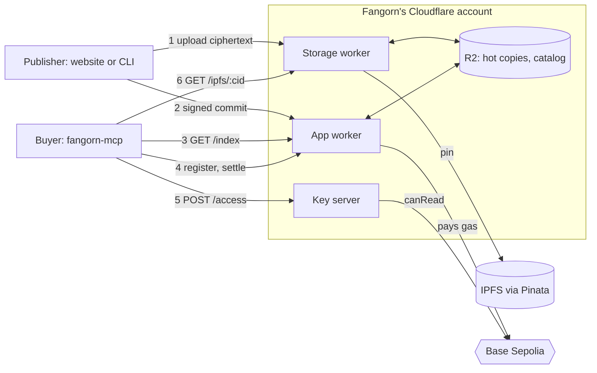

# Plan: paid records on testnet

This plan covers the server side of selling a record on Fangorn: the
Cloudflare Workers and the SDK changes they need. The goal is a testnet
release on Base Sepolia.

## Background

A publisher commits records to a repo. Repo heads live in the DataRegistry
contract and the record blocks live on IPFS. A record can have public fields
and paid fields. A paid field is encrypted before it leaves the publisher's
machine.

A buyer (usually an agent running fangorn-mcp) does four things:

1. finds a record in a catalog of public fields;
2. pays for it through the SettlementRegistry contract;
3. proves it paid without linking the paying wallet to the reading address;
4. gets the record's key and decrypts the field locally.

Rules every part keeps:

- **No Worker ever sees plaintext.** Workers handle ciphertext and keys, never
  data.
- **Fangorn takes 5% of each sale.** The treasury address is the sale's
  referrer, and the contract pays the publisher and the treasury directly, so
  the treasury never holds a publisher's money.
- **The treasury pays all gas.** Publishers and buyers never need ETH.
- **There is no server-side search.** Buyers download the catalog and search
  it locally, so nobody learns what they look for.
- **Workers keep no request logs**, only the counters that rate limits need.

## Contracts (Base Sepolia, 84532)

| Contract | Address |
|---|---|
| DataRegistry | `0x0F3eb0E62CF610dbaC6B3aD4Bf4cE38Ab50EBCC5` |
| AppRegistry | `0x197A44c42276F31DC2CeA34C138380a59A28D1C0` |
| SettlementRegistry | `0x61A5A195B54F57ada786Ba6689CdB04553cf7fBc` |
| Semaphore v4 | `0x8A1fd199516489B0Fb7153EB5f075cDAC83c693D` |
| USDC | `0x036CbD53842c5426634e7929541eC2318f3dCF7e` |

They were deployed in blocks 53592845 to 53592851. The SDK's `FangornConfig`
carries all of these.

The SettlementRegistry calls this plan uses:

- `Terms { publisher, repo, key, price, shareBps, generation, deadline }`. The
  publisher signs these (EIP-712) as the record's price tag. `repo` is
  `repoId(name)`, and `key` is the record's bytes32 key.
- `register(terms, signature, commitment, referrer, salt, payment)`. The buyer
  pays `price` in USDC with an ERC-3009 authorization and adds a Semaphore
  identity commitment for the record. The contract sends `shareBps` of the
  price to `referrer` and the rest to the publisher.
- `settle(subject, reader, depth, root, nullifier, points)`. A Semaphore proof
  that some paying identity names `reader`. After it, `reader` can read.
- `canRead(reader, publisher, repo, key)` is true once the reader has settled
  the record or the whole repo, and false if either is taken down.

SDK wrappers for these are in `src/contracts/settlement-registry/`: `signTerms`,
`register`, `settle` and `canRead`.

## Architecture



There are three Workers, one per secret. Each deploys on its own, and none
calls another.

| Worker | Package in `~/fangorn/webworker` | Job | Secret | State |
|---|---|---|---|---|
| Storage worker | `pinata-url-provider` (exists) | presigned IPFS uploads under a per-publisher quota; serves hot copies of IPFS objects from R2 | Pinata JWT | KV: quotas. R2: hot copies |
| App worker | `fangorn-app` (new) | the catalog, and the relayer that sends transactions | treasury private key | KV: rate limits. R2: `catalog.json` |
| Key server | `fangorn-access-worker` (exists, gets smaller) | releases a paid field's key to a buyer `canRead` allows | X25519 secret | none |

Splitting them this way buys two things:

- **A leak exposes one secret, not three.** In particular, a bug in the
  relayer doesn't expose the key that opens every record.
- **Publishers can host their own key server.** The default key server could
  decrypt anything deposited with it. A publisher who won't accept that deploys
  `fangorn-access-worker` on their own Cloudflare account, using the same code,
  and commits a deposit naming it. Nothing else changes for them.

Storage is in two tiers:

- **IPFS** (pinned via Pinata) is the durable copy, and anyone can fetch it by
  CID.
- **R2** is the hot copy, filled on first read. Reads come from R2 when it has
  the object, and from the IPFS gateway when it doesn't. Losing R2 loses
  nothing.

## Formats

These are fixed before any code is written. Each side codes against them and
stubs the other until it lands.

Everything below is implemented in the SDK (`src/crypto/paid.ts`), with tests
in `src/crypto/paid.test.ts` and `src/e2e/paid.e2e.test.ts`. Workers import it
rather than reimplementing it.

### Commits and epochs

A commit is `{ epoch, parent, root, repo, car }`. Its epoch is
`floor(block timestamp / 3600)` at the time the commit is made
(`EPOCH_SECONDS`, `epochOf`, `registry.epoch()`). The DataRegistry accepts an
update only if the commit's epoch is at most the current block's epoch and at
most 24 epochs (`WINDOW`, so a day) behind it. Otherwise it reverts with
`EpochOutOfWindow`.

The epoch is there so that a signed commit can't be submitted at any time after
it was made. It also dates every head, because the epoch is hashed into the
head. The window is a day because the publisher doesn't control when the
transaction lands. The derivation is in WHITEPAPER_1 §3.2, "Commit epochs".

What this means for the relayer: a `SignedUpdate` is only good for a day. Send
it promptly. If it comes back as `EpochOutOfWindow`, return the 4xx;
the publisher's client makes the commit again and signs it again. Never
queue commits for later.

### The statement

Every paid field is sealed under a statement: the chain, the
SettlementRegistry, the publisher, the repo and the repo's generation.

```
stmt = keccak256(abi.encode(string "fangorn:pay:v1", uint256 chainId, address settlementRegistry,
                            address publisher, bytes32 repo, uint64 generation))
```

`statement(scope)` computes it. Because the registry and chain are in it, a
deposit made for one deployment never opens on another. Because the generation
is in it, raising the generation starts a new set of keys.

The statement deliberately has no epoch. WHITEPAPER_2 seals a repo per epoch,
so that access expires as epochs pass. Here, keys change only when the
publisher raises the generation, so a buyer keeps access until then.
Re-sealing every hour would mean a new deposit, and re-encrypting the whole
repo, every hour.

### Keys

- **Repo key** `kRepo`: 32 bytes, one per statement. `repoKeyFrom(secret, stmt)`
  derives it from a secret only the publisher holds (the SDK uses the private
  key; the website can use a signature, if the wallet signs deterministically),
  so the publisher never stores it. `newRepoKey()` makes a random one instead.
- **Record key**: `deriveRecordKey(kRepo, stmt, key)` =
  `HKDF-SHA256(kRepo, info = stmt || key || "fangorn:record-key")`, where `key`
  is `recordKey(id)`.

### Paid field

- The ciphertext is `nonce(12) || AES-256-GCM(recordKey, plaintext, aad = stmt || key || field)`,
  stored as one file per field through the storage worker.
- In the record payload, the field's value becomes a handle. It carries no key
  material:

```json
{ "@type": "handle", "gadget": "field-v1", "generation": "0", "cid": "bafy…" }
```

`sealField({ plaintext, kRepo, scope, key, field, storage })` does both and
returns the handle. The GCM tag catches a bad copy from any cache or gateway.

### Deposit

The publisher seals `kRepo` to a key server once per statement, and commits it
as a public record with id `@deposit/<generation>`:

```json
{ "@type": "deposit", "gadget": "field-v1", "chainId": 84532, "registry": "0x…",
  "publisher": "0x…", "repo": "0x…", "generation": "0",
  "keyServer": "https://keys.fangorn.network", "sealed": "0x…" }
```

`sealed = seal(kRepo, keyServerPubkey, stmt)` (`makeDeposit`). Moving to another
key server means committing a new deposit; nothing else is resealed.

### Terms in a record

A record for sale carries its signed terms under `"@terms"`, with bigints as
decimal strings (`termsToJson` / `termsFromJson`):

```json
"@terms": {
  "terms": { "publisher": "0x…", "repo": "0x…", "key": "0x…", "price": "10000",
             "shareBps": 500, "generation": "0", "deadline": "1824000000" },
  "signature": "0x…"
}
```

A whole-repo price is the same, with `key` set to `WHOLE_REPO` (zero). Free
data goes in public fields. A sealed field is always for sale.

### Key server

**`GET /pubkey`** returns `{ "x25519": "0x…" }`.

**`POST /access`** takes (`buildAccessRequest`):

```json
{ "publisher": "0x…", "repo": "0x…", "generation": "0", "key": "0x…",
  "readerKey": "0x…", "sealed": "0x…", "timestamp": 1793640000, "signature": "0x…" }
```

- `key` is the record's key, or `WHOLE_REPO` to ask for the repo key.
- `readerKey` is a throwaway X25519 public key the buyer makes for this request.
- `sealed` is the deposit's `sealed`.
- `signature` is the reader's EIP-191 signature (`signMessage({ message: { raw } })`)
  over `accessMessage(stmt, key, readerKey, timestamp)`:

```
keccak256(abi.encode(string "fangorn:access:v1", bytes32 stmt, bytes32 key, bytes32 readerKey, uint64 timestamp))
```

`serveAccess(body, { secret, chainId, registry, canRead })` is the whole route;
the Worker only parses the body and maps `AccessError.status` (400 or 403) to
the response. It:

1. returns 400 if `|now - timestamp| > 60`;
2. recomputes `stmt` from **its own** chain id and registry, and recovers
   `reader` from the signature (`verifyAccessRequest`);
3. returns 403 if `canRead(reader, publisher, repo, key)` is false;
4. unseals `kRepo` from `sealed` under `stmt`, or returns 400;
5. returns `{ "sealed": seal(out, readerKey, stmt) }`, where `out` is `kRepo`
   for `WHOLE_REPO` and the record key otherwise.

`sealed` isn't signed, because swapping it can only unseal a deposit for the
same statement, whose keys the registry already lets the reader have. A
replayed request gets a key sealed to the original `readerKey`, useless
without its secret.

On the buyer's side, `openField({ handle, deposit, key, field, signer, storage })`
does the request, fetches the ciphertext and decrypts. A whole-repo buyer calls
`requestKey({ deposit, key: WHOLE_REPO, signer })` once, then
`deriveRecordKey` and `decryptField` per record.

### Storage worker

- `GET|POST /` mints a presigned upload URL. It's unchanged except for the
  lifetime quota (W1).
- `GET /ipfs/:cid` reads from R2 if the object is there. Otherwise it fetches
  from the IPFS gateway, stores the object in R2, and returns it. Responses are
  immutable (`Cache-Control: public, max-age=31536000, immutable`).

### App worker

**`GET /index`** returns the catalog, with `ETag`; `If-None-Match` returns 304:

```json
{ "block": "53600000",
  "entries": [
    { "publisher": "0x…", "repo": "notes", "repoId": "0x…", "key": "0x…", "id": "record-id",
      "public": { "title": "…" }, "paid": ["body"], "price": "10000",
      "terms": { … }, "signature": "0x…", "deposit": { … } } ] }
```

`deposit` is the repo's `@deposit/<generation>` record for the handles'
generation; the buyer passes it straight to `openField`. Whole-repo terms get
an entry of their own, with `key` set to `WHOLE_REPO` and no `id`.

**Relay routes** each return `{ "tx": "0x…" }`, or 4xx with the revert reason
from simulation:

| Route | Body | What the worker does |
|---|---|---|
| `POST /relay/commit` | `SignedUpdate` (bigints as strings) | limit per signer, simulate, `relayCommit` |
| `POST /relay/register` | `register`'s arguments without `referrer` | set `referrer` to AppRegistry `payoutOf(appId("fangorn"))`; limit free (`price == 0`) registers per payer; simulate; send |
| `POST /relay/settle` | `settle`'s arguments | simulate, send |

Every call is simulated first, because a reverted transaction still costs the
treasury gas. The limits per address per day are 100 commits and 20 free
registers. A paid register needs no limit, because the buyer pays more than
the gas.

## Tasks

`S` tasks are SDK work in `~/fangorn/fangorn`. `W` tasks are Worker work in
`~/fangorn/webworker`.

### SDK

| # | Task | Needs | Done when |
|---|---|---|---|
| S1 | ✅ `accessMessage`, `buildAccessRequest`, `verifyAccessRequest`, and `serveAccess`, the whole `/access` route | — | `src/crypto/paid.test.ts`: a changed field, another chain or registry, or a stale timestamp fails |
| S2 | ✅ `statement`, `repoKeyFrom`, `deriveRecordKey`, `makeDeposit`, `sealField` (uploads through `MetadataStorage.putFile`), `termsToJson` / `termsFromJson` | — | a field opens only under its own record key, statement, record and field name |
| S3 | ✅ The test chain (`src/test/testbed.ts`) also deploys SettlementRegistry with `MockUSDC` and `MockSemaphore` from the contracts repo's `test/Mocks.sol` | — | `src/e2e/paid.e2e.test.ts` |
| S4 | ✅ `requestKey` and `openField` | S1, S2 | `src/e2e/paid.e2e.test.ts`: 403 before settle, plaintext after, 403 for another record, the publisher and referrer paid; a whole-repo buyer opens every record; a takedown stops release |
| S5 | ✅ The package root imports nothing from Node (`crypto`, `Buffer` and a module-level `process.env` removed from the engine and storage) | — | a Worker importing the root bundles with `wrangler deploy --dry-run` and answers `/access` under `wrangler dev` |
| S6 | ✅ Deleted `worker-usdc-v1`, `encryptAndUpload`, `decryptHandle`, `HandleFieldInput`, `accessMessageHash` and `objectKey`. Kept `seal`, `unseal`, `sealSelf`, `unsealSelf` | S4 | westmarch imports only `seal`; the website imports none of them |
| S7 | Publish an SDK release | S1–S6 | the Workers install it from npm |

### Workers

| # | Task | Needs | Done when |
|---|---|---|---|
| W1 | Storage worker: a lifetime limit of 1 GB per publisher, next to the daily one. Keep `application/octet-stream` allowed | — | an upload past the lifetime limit is refused even when the day's quota has room |
| W2 | Storage worker: `GET /ipfs/:cid`, reading from R2 with the IPFS gateway as fallback, adding the R2 binding | — | the first read fills R2, the second is served from it, and an unknown CID returns 404 |
| W3 | Key server, removing storage: delete `/ct`, `/upload`, `DELETE /upload`, the R2 binding, key minting, `FREE_BYTES` and upload tokens. Make `WORKER_X25519_SECRET` required. Delete `SETTLEMENT_REGISTRY_ADDRESS` and `ARBITRUM_SEPOLIA_RPC` from `wrangler.toml`, which override the SDK's addresses | — | the remaining tests pass and the deleted routes return 404 |
| W4 | Key server: the new `/access` (Formats, Key server): parse the body, call the SDK's `serveAccess` with `canRead` from `SettlementRegistryClient`, map `AccessError.status` to the response. `/pubkey` serves the public half of `WORKER_X25519_SECRET` | W3, S7 | tests: 403 before settle and 200 after; 400 for a deposit made for another repo; 400 for a stale timestamp |
| W5 | App worker: a new package with the relay routes. The treasury key is a secret; the limits are in KV, following the storage worker's `RATE_KV`; every call is simulated first; the referrer is read from AppRegistry | — | tests: a call that would revert is never sent; the limit holds; a `referrer` in the body is ignored |
| W6 | App worker: the catalog. A cron trigger (every 10 minutes) lists repos with `fangorn.repos()` and reads their records. It keeps those with `"@terms"`, leaves handles out of `public`, attaches the repo's deposit, and writes `catalog.json` to R2. `/index` serves that file and makes no chain calls | W5, S5 | tests: a record with terms appears, one without doesn't, and `If-None-Match` returns 304 |
| W7 | End-to-end test on anvil: `sealField`, `/relay/commit`, the catalog cron, `/index`, `/access` refused, `/relay/register`, `/relay/settle`, `/access`, `openField` returning the plaintext | S2–S4, W2, W4–W6 | passes in CI |

W1, W2, W3 and W5 can all start on day one. W4 and W6 follow S7. W7 comes
last.

## Testnet release

1. Deploy the three Workers. The key server needs `WORKER_X25519_SECRET`. The
   app worker needs the treasury key, funded with Base Sepolia ETH, and its
   bucket. The storage worker needs its R2 binding.
2. Claim the name `fangorn` in AppRegistry, with the treasury as its payout
   address.
3. Do one real purchase end to end, with a real Semaphore proof. The anvil
   test only exercises the mocks.

## Known gaps

- **The payer and the reader can be linked.** The app worker sends both
  `register` and `settle`, seconds apart, so Fangorn could link the paying
  wallet to the reading address by timing. This is accepted for testnet, and
  nothing should claim purchases are unlinkable.
- **A takedown stops key release but can't delete the ciphertext**, because
  IPFS copies persist.
- **Settlement doesn't record a generation.** A reader who settled a record
  can ask for its key in any later generation too, so buying a record
  includes its updates. Per-generation grants would need a contract change.
- **The key server can decrypt everything deposited with it.** A publisher who
  won't accept that runs their own key server and commits a new deposit.

## Later

- Chunked ciphertext, for streaming media.
- A minimum price, so the 5% covers gas on mainnet.
- Splitting the catalog by topic, once it's too large to download whole.
