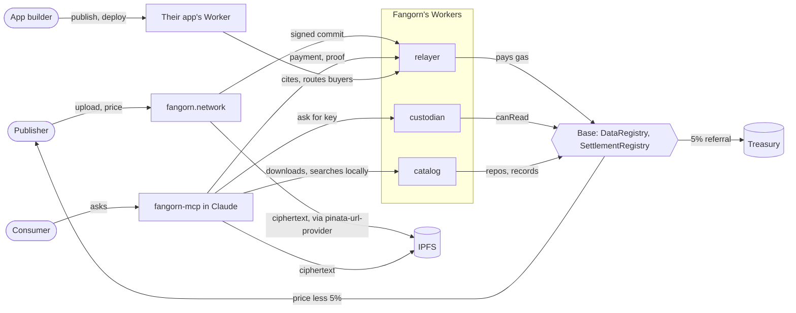
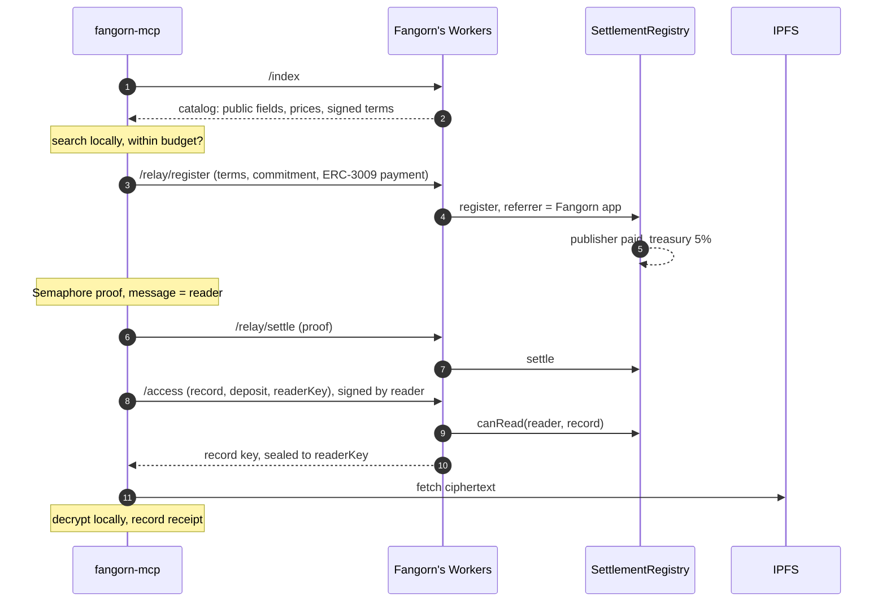

# Product: one loop, one surface each

*Working plan for the testnet release. [BACKING.md](BACKING.md) covers what
comes after it.*

## 1. The loop

A publisher logs in, uploads, chooses what is public and what is paid, sets a
price, and earns. A stranger's agent finds the record, pays, and reads it.
Nothing else ships until this works end to end.

**Done when:** a record uploaded on fangorn.network is found and bought by a
second wallet through fangorn-mcp, decrypts on the buyer's machine, and shows
as a sale on the publisher's earnings page, with the treasury's cut paid on
chain.

## 2. Surfaces

Each party gets one surface. Fangorn runs everything they don't see.

| Party | Surface | Sees | Fangorn runs for them |
|---|---|---|---|
| Publisher | fangorn.network | Upload, public or paid, price, earnings | Storage (1 GB), custodian, relayer, gas |
| Consumer | fangorn-mcp in Claude; any app's site | Answers, a monthly budget, receipts | The Fangorn app: the catalog, key sales |
| App builder | fangorn.network/#/build | Publish a repo, build, bind a card | Nothing; they run their own Worker |
| Sovereign publisher | One setting: "Hold my own keys" | A deploy button and a URL field | Nothing; they run their own custodian |

No chain, wallet, repo, Worker or key appears on the publisher's or the
consumer's surface unless they look for it.

## 3. The Fangorn app

The explorer is not special. It is an app like any other: a publisher and its
repos, with no registry entry. An app is a published view of other repos. Fangorn runs three Workers, one per secret ([PLAN.md](PLAN.md)):
the app worker (catalog and relayer), the key server (the custodian, which a
publisher who holds their own keys deploys on their own account), and the
storage worker (uploads to IPFS, hot copies in R2). Together they:

- **publishes a catalog** of every repo's public fields (from `fangorn.repos()`
  and each repo's records). It does not serve search: buyers search the
  catalog on their own machines (§5);
- **holds keys** for publishers who use the default custodian, and releases a
  record's key once `canRead` is true;
- **relays** commits, `register` and `settle`, paying the gas.

fangorn-mcp opens it by default.

**Money:**

- The buyer pays the record's price, in USDC, to SettlementRegistry through
  `register`.
- The Fangorn app is the referrer: the relayer names the treasury address.
  The website's default terms set `shareBps` to 500 (5%).
- The contract pays the treasury and the publisher directly. The treasury
  never holds a publisher's money.
- Another app that routes a sale is the referrer instead and takes the cut.
  There is one referrer per sale; a protocol fee beside it would be a contract
  change, and is deferred.
- The treasury pays all gas. Publishing is free up to the storage quota, and
  the relayer limits commits per publisher.

## 4. Keys, not data

Everything a publisher sells in a repo is sealed under one statement: the
chain, the SettlementRegistry, the publisher, the repo and its generation. One
repo key per statement; each record's key is derived from it, and each paid
field is encrypted under its record's key, bound to the statement, the record
and the field name. The ciphertext goes to IPFS. The record holds a handle
with no key material in it.

The publisher deposits the repo key once, sealed to the custodian's X25519 key,
as a public record of the repo. On a read the buyer sends the deposit; the
custodian recomputes the statement from its own chain and registry, checks
`canRead`, and returns the record's key (or, to a buyer of the whole repo, the
repo key) sealed to a throwaway key the buyer sent. The custodian stores
nothing, and a deposit made for anything else doesn't open. The buyer fetches
the ciphertext and decrypts locally. Plaintext never passes through a Worker.

The custodian could still decrypt anything deposited with it: this is the
single custodian of [WP2 §4.3]. A publisher who doesn't accept that runs the
same custodian code on its own Cloudflare account (scheme 0) and commits a new
deposit for it. Nothing else is resealed.

## 5. Privacy

**The rule:** Fangorn never sees what anyone searches for, and measures demand
only from what people pay for.

- **Search is local.** fangorn-mcp downloads the catalog, keeps it cached, and
  searches it on the buyer's machine. The Worker learns that someone fetched
  the catalog, nothing more. Ceiling: once the catalog passes tens of MB it
  splits into pieces by topic, and fetching a piece reveals that coarse topic.
- **Demand comes from sales.** A sale is public anyway: `Registered` shows
  which record sold, and at what price. The publisher's earnings page shows
  these as what buyers want. Queries are never collected to measure demand.
- **Payer and reader can be linked, for now.** Semaphore separates the wallet
  that pays from the address that reads. But one relayer submits both
  `register` and `settle` and then serves `/access`, seconds apart, so it can
  link them by timing. Until `settle` takes another path (§10), nothing claims
  purchases are unlinkable.
- **The custodian sees what the chain shows.** `/access` reveals the reader and
  the record, which `settle` already put on chain.
- **No logs.** The Worker stores no requests, only the per-address counters
  the relayer's limits need (§11). Cloudflare sees IP addresses; the Worker
  does not keep them.

## 6. Flows

**Publish (website):**

1. Log in (Privy); the embedded wallet is the publisher.
2. Drop a CSV, a JSON array, or a folder. Each row or file is a record.
3. Mark each field public or paid. Public fields are what the catalog
   carries: at least a title or description.
4. Set a default price; override per record if wanted.
5. Save: paid fields are encrypted under the repo's keys and the ciphertext
   goes to IPFS through the storage worker; the repo key is deposited with
   the custodian (once per generation); the terms are signed (`signTerms`)
   and stored with the record; the commit goes through the relayer.

**Buy (fangorn-mcp):**

1. Refresh the cached catalog; search it locally; pick a record; read its
   terms and price.
2. Check the budget (the ledger in `~/.fangorn/spend.json`).
3. Create a Semaphore identity for the subject; sign an ERC-3009 payment;
   the relayer submits `register` with the Fangorn app as the referrer.
4. Prove membership with the reader address as the message; the relayer
   submits `settle`.
5. Ask the custodian for the key, signed by the reader; fetch the
   ciphertext; decrypt; record the receipt.

## 7. Interfaces

The exact shapes (the statement, the handle, the deposit, `/access`, `/index`,
the relay routes) are in [PLAN.md](PLAN.md), under Formats, fixed first so the work in §8 runs in
parallel. In short:

| Route | Part | Does |
|---|---|---|
| `GET /index` | catalog | every record for sale: public fields, price, signed terms; with an ETag |
| `GET /pubkey` | custodian | the X25519 key deposits are sealed to |
| `POST /access` | custodian | checks the reader's signature and `canRead`, returns the record's key (or the repo key) sealed to the reader |
| `POST /relay/commit`, `/relay/register`, `/relay/settle` | relayer | simulates, then sends, paying the gas; sets the referrer itself |

A sealed field is always paid; free data goes in public fields.

## 8. Work

| # | Stream | Lives in | Owner | Needs | Done when |
|---|---|---|---|---|---|
| A | ✅ Deploy SettlementRegistry on Base Sepolia, with Semaphore; add its address to the network config | contracts, SDK | contracts/SDK | — | `canRead` reads from the SDK's default config |
| B | ✅ SDK: `sealField`, `openField`, deposits, `serveAccess`, a workerd-safe root, the testbed's SettlementRegistry. Tasks S1–S6 in [PLAN.md](PLAN.md); S7 (publish) remains | SDK | contracts/SDK | — | `src/e2e/paid.e2e.test.ts` on anvil |
| C | Workers: the key server made stateless and gated on `canRead`, the new app worker (catalog, relayer), the storage worker's 1 GB cap and R2 hot copies. Tasks W1–W7 in [PLAN.md](PLAN.md) | `~/fangorn/webworker` | colleague | B's request format (stubbed until merged); A on anvil | an anvil e2e: commit, register, settle, `/access` succeed through them; `/access` refuses before settle; `/index` lists the record |
| D | Buyer path in fangorn-mcp: a cached catalog with local keyword search, and a `buy` tool doing §6 Buy, under the budget | westmarch `src/agent/mcp.js` | agent | §7 shapes; C on anvil | the same anvil e2e driven from the MCP tools |
| E | Website publisher flow: upload, public or paid, price, earnings (with sales as demand); apps move to `/build` | website | agent | §7 shapes; the publisher's uncommitted edits merged first | a second wallet buys a record uploaded from the page, against anvil or testnet |
| F | Testnet release: deploy C, set the treasury address, fund the treasury's relayer key, publish fangorn-mcp, deploy the website | all | contracts/SDK | A–E | §1's done-when, on Base Sepolia |

A and B are done (B's publish, S7, remains). C and D start against stubs and anvil the same
day; E starts once the website's pending edits are in.

## 9. Defaults and limits

- **Storage:** 1 GB of pinning per publisher.
- **Gas:** paid by the treasury; the relayer caps commits per publisher per
  day.
- **Fee:** 5% referral to the treasury on sales through the Fangorn app.
- **Budget:** fangorn-mcp spends nothing unless a budget or wallet key is
  set; then $5 a month by default.
- **Search:** local keyword search over the cached catalog; by meaning later.

## 10. Deferred

- Search by meaning over the catalog, still local.
- Splitting the catalog by topic, once it is too large to download whole.
- Unlinking payer and reader: `settle` submitted by another path than
  `register`, at a random delay, or by the reader itself; and a fresh reader
  address per purchase, so one buyer's purchases don't link.
- Opt-in wants: a person, through their agent, posts what they are looking
  for, to show publishers unmet demand ([BACKING.md](BACKING.md) §10). Never
  collected from queries; aggregated only above a minimum of distinct people.
- "Hold my own keys": the custodian deploy, and a URL field per repo.
- A protocol fee beside app referral.
- Email sign-in and dollar payouts in fangorn-mcp.
- Backing ([BACKING.md](BACKING.md)).

## 11. Decisions

1. **Semaphore:** the instance already on Base Sepolia, Deploy.s.sol's
   default.
2. **Terms:** a signed price tag, not legal text. SettlementRegistry's
   `Terms` (publisher, repo, key, price, `shareBps`, generation, deadline),
   signed by the publisher with EIP-712. `register` checks the signature, so
   a buyer can't pay less or route the cut elsewhere. They live in the
   record's public fields, next to its signature, so the catalog carries
   them. The website sets a long deadline; raising a repo's generation voids
   them all. Licence text, if added, goes in as a hash in the same terms.
3. **Proofs:** fangorn-mcp generates them locally with
   `@semaphore-protocol/proof`, which downloads the circuit's proving files
   (a few MB, per tree depth) on first use and caches them. The first buy is
   slower; later ones aren't.
4. **Relayer limits:** the relayer pays gas for whatever it submits, and a
   transaction that reverts still costs gas. So it simulates every call first
   and submits only what would succeed. A paid `register` then costs the
   buyer more than the gas, but a free record's (price 0) costs the buyer
   nothing, so free registers and commits are capped per address per day.
5. **Search:** on the buyer's machine, over a downloaded catalog (§5).
6. **Wants:** after the testnet release (§10).
